# 1) Diagrama conceptual de Arnold (extraído del código)

> **Fuente de verdad**: `arnold/prisma/schema.prisma` (810 líneas, leído completo).
> **Fecha de extracción**: 2026-11-16.
> **Método**: una clase por `model` de negocio, atributos tal como los declara Prisma (tipo y
> nulabilidad), relaciones tal como las declaran los campos `@relation` y las multiplicidades que
> imponen los `@unique` y las claves ajenas opcionales.
> **Sin invención**: lo que no existe en el schema figura como "no existe" en las secciones finales.

## Criterio de inclusión

| Incluido | Motivo |
|---|---|
| 24 modelos de negocio | Tienen significado en el dominio del gimnasio. |
| **Excluido**: `RefreshToken`, `TokenRevocation`, `RateLimitLog` | Son tablas **puramente técnicas** (sesiones, revocación y control de tasa). No describen conceptos del negocio. Se listan al final, sólo para dejar constancia de que existen y se omitieron a propósito. |

Las claves ajenas (`usuarioId`, `socioId`, …) **no se repiten como atributos** del diagrama: su
información está expresada en la relación. Cuando la FK es opcional la relación es `0..1`.

## Diagrama

```mermaid
classDiagram
    class Usuario {
        String id
        String nombre
        String email
        String password
        Rol rol
        EstadoUsuario estado
        DateTime createdAt
        DateTime updatedAt
        DateTime deletedAt
    }
    class Socio {
        String id
        String dni
        String telefono
        DateTime fechaAlta
        EstadoCuota estadoCuota
        String pinHash
        Int huellaId
        DateTime huellaConsentimientoEn
        Decimal pesoObjetivo
        Decimal pesoInicialDeMeta
        DateTime updatedAt
    }
    class Empleado {
        String id
        Turno turno
        EstadoLaboral estadoLaboral
        DateTime updatedAt
    }
    class Membresia {
        String id
        String nombre
        Decimal precio
        Int periodicidad
        String descripcion
        EstadoMembresia estado
        DateTime createdAt
        DateTime updatedAt
    }
    class Cuota {
        String id
        DateTime fechaInicio
        DateTime fechaVencimiento
        EstadoCuotaModel estado
        DateTime createdAt
        DateTime updatedAt
    }
    class Pago {
        String id
        DateTime fechaPago
        Decimal monto
        MetodoPago metodoPago
        EstadoPago estado
        Decimal montoLista
        Decimal descuentoPct
        DateTime createdAt
    }
    class Ejercicio {
        String id
        String nombre
        String grupoMuscular
        String descripcion
        String datasetId
        String equipamiento
        String musculoObjetivo
        String musculosSecundarios
        String instrucciones
        String mediaId
        DateTime createdAt
        DateTime updatedAt
    }
    class Rutina {
        String id
        String nombre
        String objetivoPrincipal
        Int frecuenciaSemanal
        Int duracionEstimada
        NivelDeDificultad nivelDeDificultad
        String descripcion
        DateTime createdAt
        DateTime updatedAt
    }
    class EjercicioEnRutina {
        String id
        Int series
        Int repeticiones
        Int descanso
        Int orden
        DateTime createdAt
        DateTime updatedAt
    }
    class RutinaAsignada {
        String id
        DateTime fechaAsignacion
        Boolean activa
        DateTime createdAt
        DateTime updatedAt
    }
    class Maquina {
        String id
        String nombre
        TipoEquipamiento tipoEquipamiento
        EstadoMaquina estado
        String ubicacion
        DateTime fechaAlta
        DateTime updatedAt
    }
    class EjercicioMaquina {
        String id
        DateTime createdAt
    }
    class Asistencia {
        String id
        DateTime fechaHora
        EstadoAlIngresar estado
        String razon
        MetodoIdentificacion metodo
        Boolean autorizadoExcepcionalmente
    }
    class SesionDeEntrenamiento {
        String id
        DateTime horaInicio
        DateTime horaFin
        EstadoSesion estadoDeFinalizacion
        String ejercicioActualId
        Int serieActual
        String observaciones
        DateTime createdAt
    }
    class RegistroDeProgreso {
        String id
        Decimal carga
        Int repeticiones
        Decimal pesoCorporal
        Int rir
        Int numeroSerie
        TipoSerie tipo
        DateTime fecha
    }
    class MedicionDePeso {
        String id
        Decimal peso
        DateTime fecha
        DateTime createdAt
    }
    class ReglaDeProgresion {
        String id
        TipoProgresion tipo
        Decimal incrementoSugerido
    }
    class CierreDeCaja {
        String id
        Decimal totalRecaudado
        Decimal totalEfectivo
        Decimal totalTransferencia
        Decimal totalTarjeta
        Int cantidadOperaciones
        String observaciones
        DateTime createdAt
    }
    class RegistroDeAuditoria {
        String id
        TipoOperacion tipoOperacion
        DateTime fechaHora
        String detalles
    }
    class AuditoriaAcceso {
        String id
        AccionAcceso accion
        String motivo
        ResultadoAcceso resultado
        DateTime timestamp
        String ipAddress
        String userAgent
        DateTime createdAt
    }
    class Dispositivo {
        String id
        String nombre
        TipoDispositivo tipo
        String tokenHash
        String tokenPrefix
        EstadoDispositivo estado
        DateTime ultimoContacto
        DateTime createdAt
        DateTime updatedAt
    }
    class ConfiguracionDelSistema {
        String id
        Int capacidadMaxima
        Int periodoGracia
        Int diasInactividad
        Decimal descuentoReactivacion
        Int ventanaAforoMinutos
        Int diaLimitePago
        Int diaCorteAltaTardia
        Int antiPassbackMinutos
        Int diasSinAsistirParaOferta
        Int enfriamientoOfertaDias
        Boolean ofertaReactivacionActiva
        Int segundosEjecucionSerie
        Int minutosVencimientoReserva
        Int minutosInactividadSesion
        DateTime updatedAt
    }
    class SolicitudDeHuella {
        String id
        AccionHuella accion
        Int huellaId
        EstadoSolicitudHuella estado
        String motivo
        Int duplicadoDe
        DateTime createdAt
        DateTime resueltaEn
    }
    class AsignacionDeEjercicio {
        String id
        EstadoAsignacion estado
        Int esperaSegundos
        Int ahorroSegundos
        DateTime creadaEn
        DateTime venceEn
    }

    Usuario "1" -- "0..1" Socio : usuario
    Usuario "1" -- "0..1" Empleado : usuario
    Usuario "1" -- "0..*" RegistroDeAuditoria : responsable
    Usuario "0..1" -- "0..*" AuditoriaAcceso : usuario

    Membresia "0..1" -- "0..*" Socio : membresiaAsignada
    Membresia "0..1" -- "0..*" Cuota : planPagado
    Socio "1" -- "0..*" Cuota : cuotas
    Socio "0..1" -- "0..*" Pago : pagos
    Cuota "0..1" -- "0..*" Pago : pagos
    CierreDeCaja "0..1" -- "0..*" Pago : pagosDelCierre
    Empleado "1" -- "0..*" CierreDeCaja : responsable

    Rutina "1" -- "0..*" EjercicioEnRutina : ejercicios
    Ejercicio "1" -- "0..*" EjercicioEnRutina : rutinas
    Rutina "1" -- "0..*" RutinaAsignada : asignaciones
    Socio "1" -- "0..*" RutinaAsignada : rutinasAsignadas
    RutinaAsignada "1" -- "0..*" SesionDeEntrenamiento : sesiones
    Socio "1" -- "0..*" SesionDeEntrenamiento : sesiones
    SesionDeEntrenamiento "0..1" -- "0..*" RegistroDeProgreso : registros
    Socio "1" -- "0..*" RegistroDeProgreso : registrosProgreso
    Ejercicio "1" -- "0..*" RegistroDeProgreso : registrosProgreso
    Socio "1" -- "0..*" MedicionDePeso : mediciones

    Socio "1" -- "0..*" Asistencia : asistencias
    Socio "1" -- "0..*" SolicitudDeHuella : solicitudesHuella
    Socio "0..1" -- "0..*" AuditoriaAcceso : socio

    Ejercicio "1" -- "0..*" EjercicioMaquina : maquinas
    Maquina "1" -- "0..*" EjercicioMaquina : ejercicios
    Socio "1" -- "0..*" AsignacionDeEjercicio : asignacionesDeEjercicio
    Ejercicio "1" -- "0..*" AsignacionDeEjercicio : asignaciones
    Maquina "0..1" -- "0..*" AsignacionDeEjercicio : asignaciones
    SesionDeEntrenamiento "0..1" -- "0..*" AsignacionDeEjercicio : asignaciones
```

> `ReglaDeProgresion`, `Dispositivo` y `ConfiguracionDelSistema` **no tienen relaciones**: son
> tablas de parámetros (reglas de progresión por tipo, dispositivos autorizados y configuración
> singleton de hecho).
>
> Para que el diagrama sea legible, los tipos se escriben sin modificadores: `musculosSecundarios`
> e `instrucciones` son **listas** (`String[]` en Prisma), los `Decimal` son `Decimal(10,2)` o
> `Decimal(5,2)` según el campo, y los atributos sin marca son **obligatorios** salvo los que el
> schema declara opcionales (`telefono`, `descripcion`, `pinHash`, `huellaId`, `mediaId`,
> `motivo`, `razon`, `observaciones`, `horaFin`, `ejercicioActualId`, `serieActual`, `pesoCorporal`,
> `rir`, `numeroSerie`, `duplicadoDe`, `resueltaEn`, `ultimoContacto`, `montoLista`, `descuentoPct`,
> `detalles`). Los detalles exactos están en `prisma/schema.prisma`.

## Enumeraciones usadas por los atributos

Fuente: `prisma/schema.prisma` → bloques `enum`.

| Enum | Valores |
|---|---|
| `Rol` | `ADMINISTRADOR`, `INSTRUCTOR`, `RECEPCIONISTA`, `SOCIO` |
| `EstadoUsuario` | `ACTIVO`, `INACTIVO`, `BLOQUEADO` |
| `Turno` | `MANANA`, `TARDE`, `NOCHE` |
| `EstadoLaboral` | `ACTIVO`, `INACTIVO`, `LICENCIA` |
| `EstadoMembresia` | `ACTIVA`, `INACTIVA` |
| `EstadoCuota` | `AL_DIA`, `INACTIVA`, `BLOQUEADA` (estado de la **cuenta**, no del pago) |
| `EstadoCuotaModel` | `VIGENTE`, `VENCIDA` (estado de una fila `Cuota`) |
| `MetodoPago` | `EFECTIVO`, `TRANSFERENCIA`, `TARJETA` |
| `EstadoPago` | `CONFIRMADO`, `PENDIENTE`, `ANULADO` |
| `NivelDeDificultad` | `BASICO`, `INTERMEDIO`, `AVANZADO` |
| `TipoEquipamiento` | `MAQUINA_GUIADA`, `PESO_LIBRE`, `CARDIO` |
| `EstadoMaquina` | `DISPONIBLE`, `OCUPADA`, `FUERA_DE_SERVICIO`, `INACTIVA` |
| `EstadoAlIngresar` | `PERMITIDO`, `DENEGADO` |
| `MetodoIdentificacion` | `DNI_PIN`, `MANUAL`, `HUELLA` |
| `EstadoSesion` | `EN_CURSO`, `COMPLETADA`, `INCOMPLETA`, `ABANDONADA` |
| `TipoSerie` | `NORMAL`, `CALENTAMIENTO`, `HASTA_EL_FALLO`, `DROP_SET` |
| `TipoProgresion` | `LINEAL`, `ONDULANTE` |
| `TipoOperacion` | `ALTA`, `BAJA`, `MODIFICACION`, `ANULACION` |
| `AccionAcceso` | `LOGIN`, `CHECK_IN`, `OVERRIDE_GRANT`, `MANUAL_DENY`, `ACCESS_DENIED` |
| `ResultadoAcceso` | `ALLOW`, `DENY` |
| `TipoDispositivo` | `PUERTA`, `RECEPCION` |
| `EstadoDispositivo` | `ACTIVO`, `INACTIVO` |
| `AccionHuella` | `ENROLAR`, `BORRAR` |
| `EstadoSolicitudHuella` | `PENDIENTE`, `CONFIRMADA`, `FALLIDA` |
| `EstadoAsignacion` | `RESERVADA`, `EN_CURSO`, `COMPLETADA`, `CANCELADA` |

## Diferencias contra la lista de conceptos del Análisis actual

### A. Conceptos de la lista que **NO existen** como entidad en el schema

| Concepto del Análisis | Estado en el código | Evidencia |
|---|---|---|
| **Notificación** | **NO IMPLEMENTADO**. No hay modelo, tabla ni endpoint de notificaciones. Tampoco queda un elemento de interfaz: la campana inerte que tenía la barra horizontal se retiró con el rediseño del rail. | `prisma/schema.prisma` (no aparece); no hay `src/app/api/notificaciones` |
| **OcupacionPorFranja** | **NO IMPLEMENTADO**. La ocupación por franja se **calcula** desde `Asistencia` en memoria; no se persiste. | `src/domains/home-interno/home-interno.ts` (`buildAforoHoras`) |
| **IntentoDeRecuperacion** | **NO IMPLEMENTADO**. No hay tabla de intentos de recuperación de contraseña/seguridad. | `prisma/schema.prisma`; no hay rutas de recuperación |
| **UsoDeMaquina** | **NO IMPLEMENTADO** con ese nombre. El uso de una máquina se modela como `AsignacionDeEjercicio` en estado `EN_CURSO`; la ocupación se **deriva**, no se guarda en una tabla propia. | `prisma/schema.prisma` → `AsignacionDeEjercicio`; `src/domains/asignacion/asignacion-ocupacion.ts` |
| **Instructor** | **No es una entidad**: es un valor del enum `Rol`. | `enum Rol` |
| **Recepcionista** | **No es una entidad**: es un valor del enum `Rol`. | `enum Rol` |
| **Administrador** | **No es una entidad**: es un valor del enum `Rol`. | `enum Rol` |

### B. Entidades del schema que **NO están** en la lista del Análisis

| Entidad | Qué modela | Por qué falta en el Análisis |
|---|---|---|
| `RutinaAsignada` | La asignación concreta de una rutina a un socio, con `activa` (RN-04) | El Análisis tenía `Rutina` y `Sesión`, pero no la entidad intermedia |
| `EjercicioMaquina` | M2M explícito ejercicio ↔ máquina (candidatas del motor) | Concepto nuevo de la Etapa 5 |
| `MedicionDePeso` | Un pesaje corporal por fila (serie histórica del socio) | Concepto nuevo del tracking |
| `AuditoriaAcceso` | Log de login / check-in / accesos denegados (con IP y user-agent) | El Análisis sólo tenía `RegistroDeAuditoría` |
| `Dispositivo` | Lector de puerta autorizado por token | Concepto nuevo (T-036) |
| `SolicitudDeHuella` | Cola de enrolamiento/baja de huella para el sensor | Concepto nuevo (T-041) |
| `AsignacionDeEjercicio` | Reserva/ejecución del motor de asignación dinámica | Concepto nuevo de la Etapa 5 |

### C. Correspondencias con nombre distinto (para no confundirlas)

| Análisis | Schema |
|---|---|
| Membresía | `Membresia` |
| SesiónDeEntrenamiento | `SesionDeEntrenamiento` |
| RegistroDeProgreso | `RegistroDeProgreso` |
| ConfiguraciónDelSistema | `ConfiguracionDelSistema` |
| RegistroDeAuditoría | `RegistroDeAuditoria` |
| Cliente | `Socio` (el dominio `Cliente` es la vista CRUD de `Socio`) |

### D. Tablas excluidas a propósito del diagrama

| Tabla | Motivo |
|---|---|
| `RefreshToken` | Técnica: rotación de sesión (hash del token, vencimiento, `replacedByTokenId`). |
| `TokenRevocation` | Técnica: revocación de JWT en el logout. |
| `RateLimitLog` | Técnica: conteo de intentos por IP. |

## Trazabilidad

- Modelos, atributos, enums y relaciones: `arnold/prisma/schema.prisma`.
- Cálculo de ocupación por franja (no persistida): `arnold/src/domains/home-interno/home-interno.ts`.
- Ocupación de máquinas derivada: `arnold/src/domains/asignacion/asignacion-ocupacion.ts`.
- Ausencia de notificaciones y de recuperación de contraseña: no existe ruta ni modelo.
