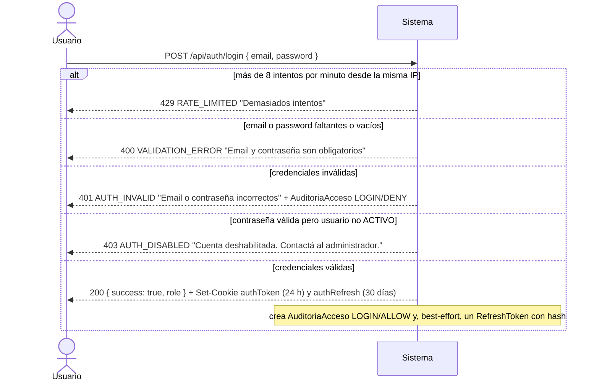
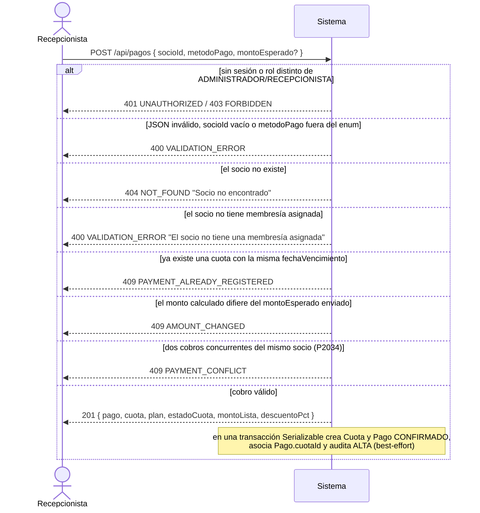
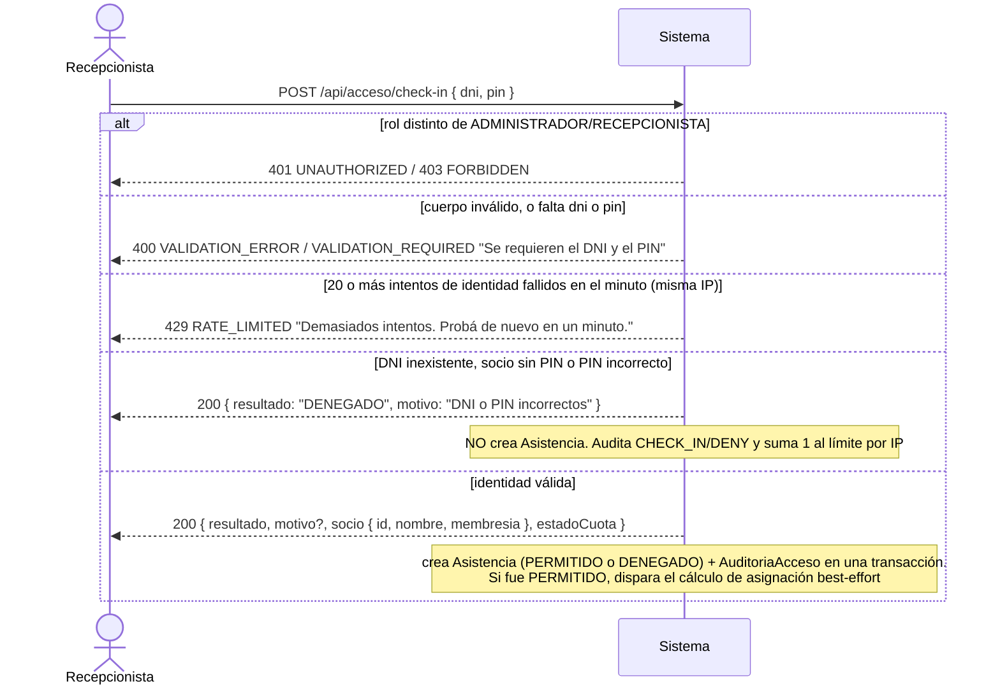
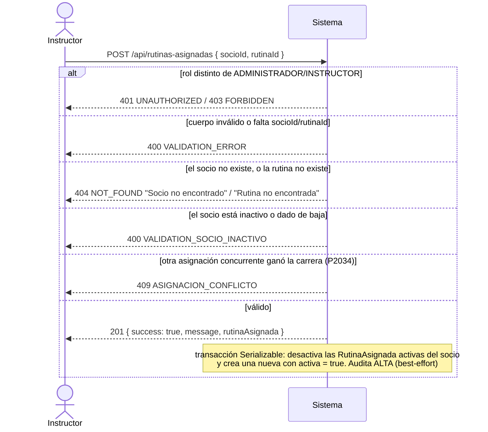
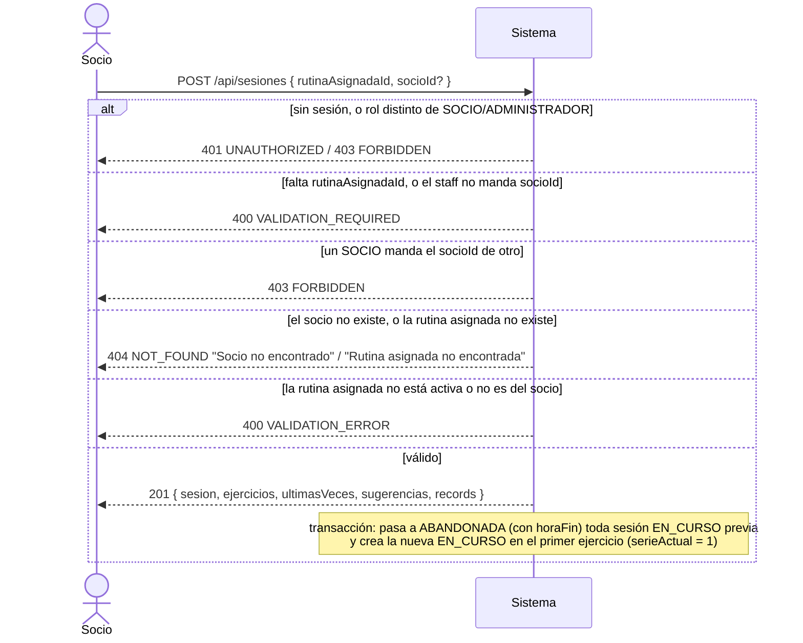
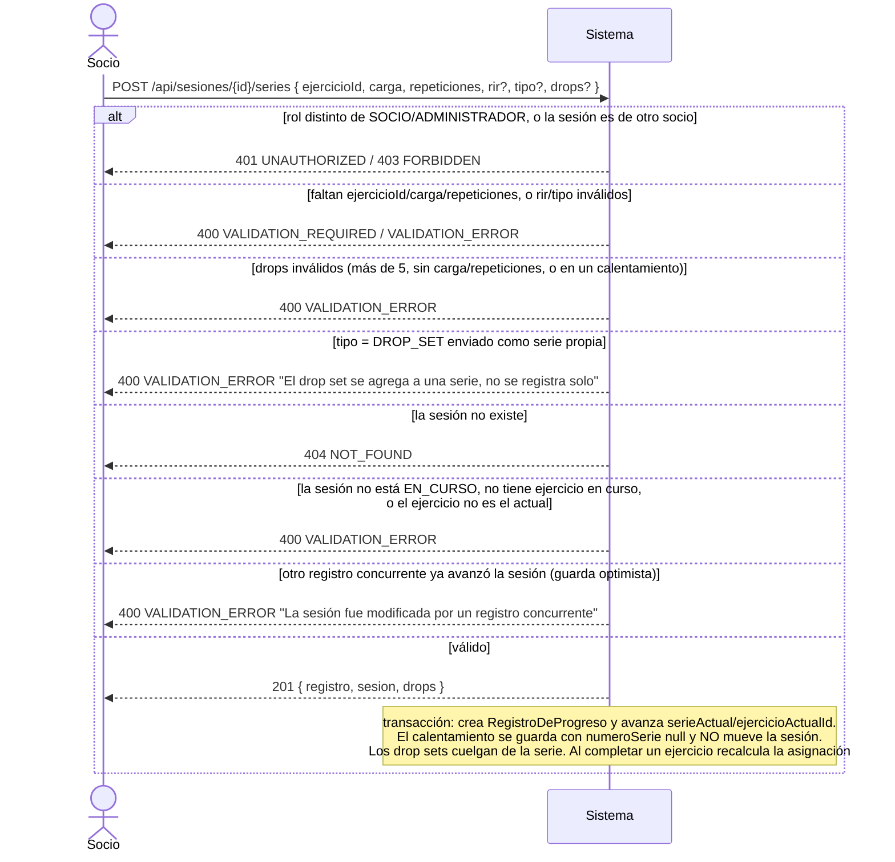
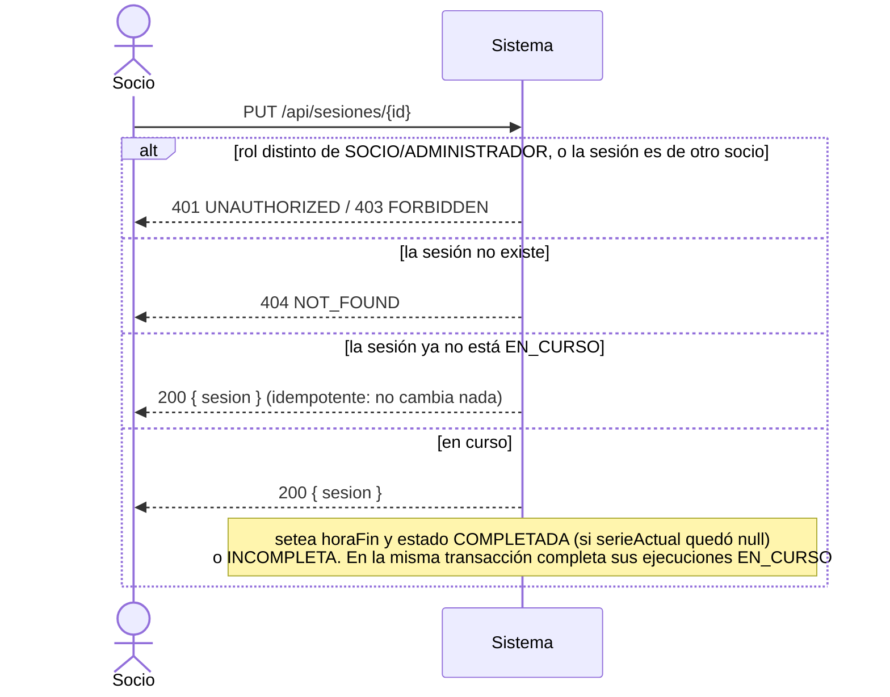
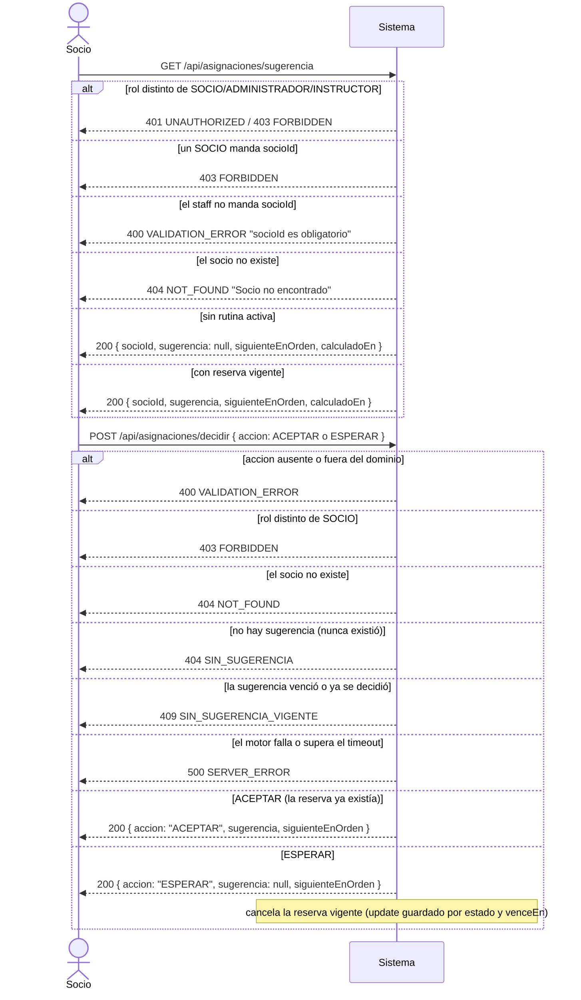
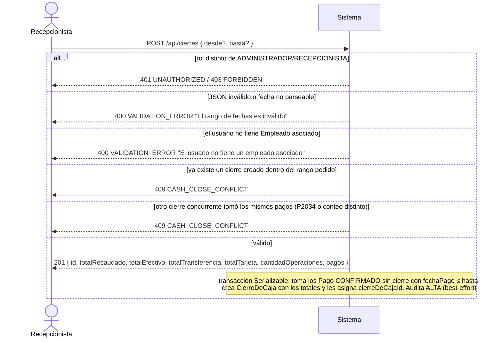

# 2) Diagramas de secuencia del sistema (SSD)

> **Fuente de verdad**: `arnold/src/app/api/**/route.ts` (validación de entrada y códigos HTTP) y
> `arnold/src/api/*.ts` + `arnold/src/domains/*` (reglas y errores de dominio).
> **Fecha de extracción**: 2026-11-16.
> **Convención**: dos participantes. El actor y **Sistema** como caja negra. No se muestran capas
> internas (proxy, handler, repositorio, Prisma): todos son "Sistema".
> Cada respuesta de error indica **código HTTP + `code` + motivo real** tomado del código.
> Si una regla no existe en el código, se indica **NO IMPLEMENTADO** en lugar de suponerla.

Los errores transversales **401 `UNAUTHORIZED`** y **403 `FORBIDDEN`** los puede devolver cualquier
operación autenticada: el `401` cuando falta el token de sesión y el `403` cuando el rol no tiene el
permiso (matriz en `src/lib/authorization.ts`, chequeo repetido en cada handler). Se listan sólo
donde agregan información; se omiten del dibujo para no repetirlos nueve veces.

---

## 1. Iniciar sesión

Fuente: `src/app/api/auth/login/route.ts`, `src/api/auth.ts`, `src/lib/refresh-token.ts`,
rate limit del proxy (`src/proxy.ts` + `src/lib/rateLimit.ts`).

---

## 2. Registrar pago

Fuente: `src/app/api/pagos/route.ts`, `src/api/pagos.ts`, `src/domains/pago/registrar-pago.ts`.

---

## 3. Check-in por DNI y PIN

Fuente: `src/app/api/acceso/check-in/route.ts`, `src/api/acceso.ts`
(`handleCheckIn` y `evaluarYRegistrarAcceso`).

> `resultado` puede ser `PERMITIDO`, `PERMITIDO_CON_AVISO` (cuota pendiente) o `DENEGADO`
> (cuota vencida, cuenta inactiva/bloqueada o anti-passback).

---

## 4. Asignar rutina

Fuente: `src/app/api/rutinas-asignadas/route.ts`, `src/domains/rutina/asignar-rutina.ts`.

---

## 5. Iniciar sesión de entrenamiento

Fuente: `src/app/api/sesiones/route.ts`, `src/domains/sesion/sesion-de-entrenamiento.ts`
(`iniciarSesion`).

---

## 6. Registrar serie

Fuente: `src/app/api/sesiones/[id]/series/route.ts`, `src/domains/sesion/sesion-de-entrenamiento.ts`
(`registrarSerie`).

---

## 7. Finalizar sesión

Fuente: `src/app/api/sesiones/[id]/route.ts`, `src/domains/sesion/sesion-de-entrenamiento.ts`
(`finalizarSesion`).

---

## 8. Sugerencia y decisión de asignación dinámica

Fuente: `src/app/api/asignaciones/sugerencia/route.ts`,
`src/app/api/asignaciones/decidir/route.ts`, `src/api/asignaciones.ts`,
`src/domains/asignacion/orquestacion.ts`.

> **Importante**: la fila `RESERVADA` **no la crea** el `GET` ni el `ACEPTAR`. La crea el cálculo
> (`calcularYReservar`), que se dispara en el check-in y en los eventos de sesión
> (`src/domains/asignacion/orquestacion.ts:101` y `:339`). El comentario del código es explícito:
> "ACEPTAR no escribe" (`orquestacion.ts:242`).

---

## 9. Registrar cierre de caja

Fuente: `src/app/api/cierres/route.ts`, `src/api/cierres.ts`, `src/domains/cierre/cierre-de-caja.ts`.

> Sin `desde`/`hasta`, el rango por defecto es desde el inicio del día del gimnasio hasta "ahora"
> (`rangoPorDefecto` en `src/api/cierres.ts`). El cierre **no** acota inferiormente los pagos
> (`fechaPago ≤ hasta`): recoge también pagos viejos que quedaron sin cierre (CC-4).

---

## Cobertura y límites

| Caso de uso pedido | Diagrama | ¿Existe en el código? |
|---|---|---|
| Iniciar sesión | 1 | Sí |
| Registrar pago | 2 | Sí |
| Check-in por DNI y PIN | 3 | Sí |
| Asignar rutina | 4 | Sí |
| Iniciar sesión de entrenamiento | 5 | Sí |
| Registrar serie | 6 | Sí |
| Finalizar sesión | 7 | Sí |
| Sugerencia y decisión de asignación | 8 | Sí |
| Registrar cierre de caja | 9 | Sí |
| Notificaciones al socio | — | **NO IMPLEMENTADO**: no hay endpoint ni modelo |
| Recuperación de contraseña | — | **NO IMPLEMENTADO**: no hay flujo ni tabla |
