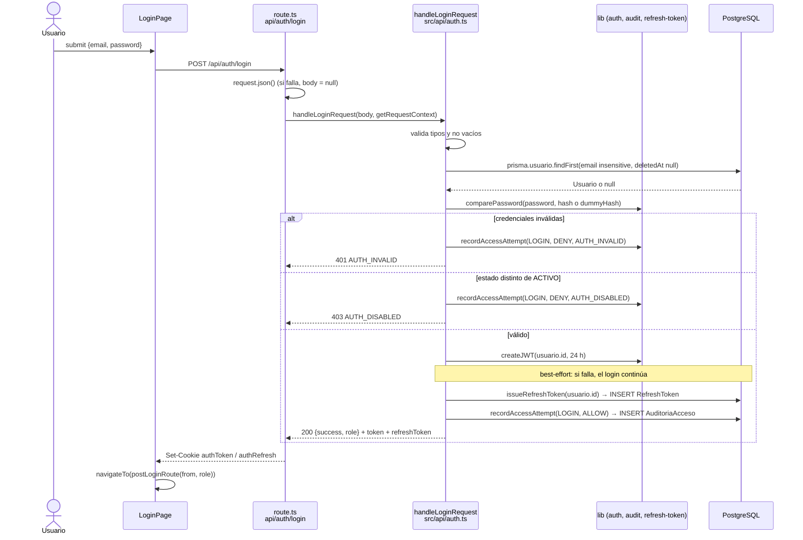
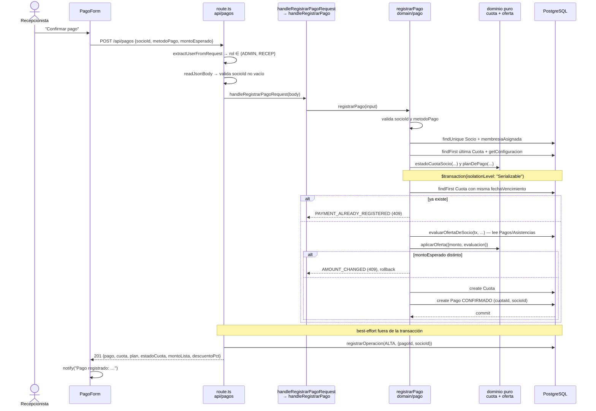
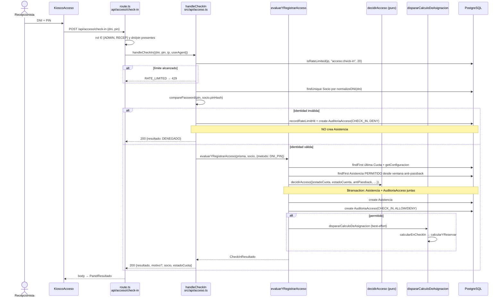
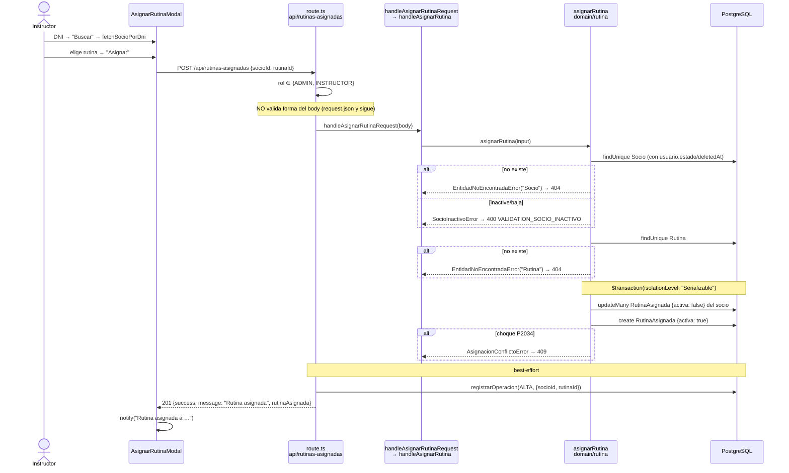
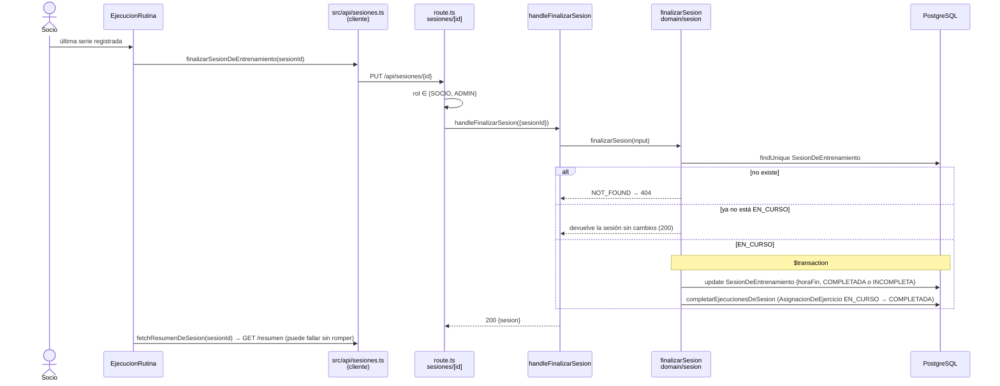
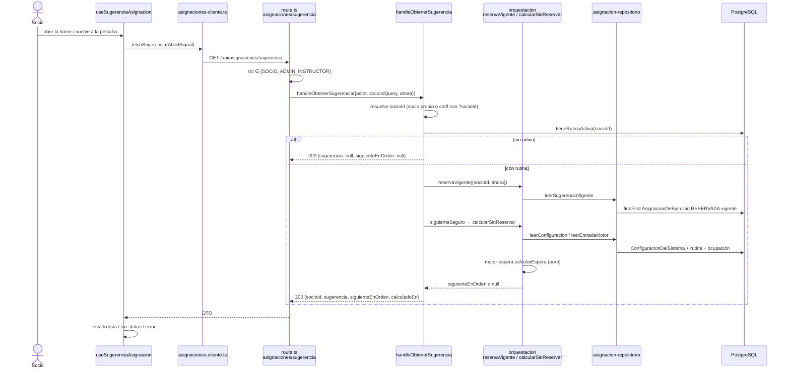

# 6) Diagramas de interacción por capas

> **Fuente**: `arnold/src/` leído en la fecha 2026-11-16. Los nombres de funciones y archivos son
> literales. Las transacciones, aislamientos, locks y llamadas best-effort están marcados con `Note`.
> **Capas**: UI → `route.ts` → handler de aplicación (`src/api`) → dominio (`src/domains`) → acceso a
> datos (`prisma` / `src/lib`) → base de datos. Cuando una capa no existe, se dice.

---

## 1. Iniciar sesión



**Sin dominio**: la ruta no tiene `src/domains`; toda la lógica vive en `src/api/auth.ts`. Las
escrituras de auditoría y refresh **no comparten transacción** con nada.

---

## 2. Registrar pago



Un `P2034` de la transacción se traduce a `PAYMENT_CONFLICT` (`registrar-pago.ts:239-242`).

---

## 3. Registrar ingreso por DNI y PIN



---

## 4. Asignar rutina



---

## 5. Iniciar sesión de entrenamiento

```mermaid
sequenceDiagram
    actor So as Socio
    participant UI as EjecucionRutina
    participant C as src/api/sesiones.ts<br/>(cliente)
    participant R as route.ts<br/>api/sesiones
    participant H as handleIniciarSesion
    participant D as iniciarSesion<br/>domain/sesion
    participant DB as PostgreSQL

    So->>UI: "Empezar entrenamiento"
    UI->>C: fetchSesionEnCurso() → GET /api/sesiones?enCurso=1
    alt no hay sesión
        UI->>C: iniciarSesionDeEntrenamiento({rutinaAsignadaId})
        C->>R: POST /api/sesiones
        R->>R: rol ∈ {SOCIO, ADMIN}; resuelve socioId propio
        R->>H: handleIniciarSesion({socioId, rutinaAsignadaId})
        H->>D: iniciarSesion(input)
        D->>DB: findUnique Socio
        D->>DB: findUnique RutinaAsignada (rutina + ejercicios ordenados)
        D->>DB: leerReservaVigenteParaSesion (AsignacionDeEjercicio)
        Note over D,DB: $transaction
        D->>DB: updateMany SesionDeEntrenamiento EN_CURSO → ABANDONADA (horaFin)
        D->>DB: create SesionDeEntrenamiento EN_CURSO (ejercicioActualId, serieActual 1)
        alt hay reserva de la rutina
            D->>DB: consumirReservaParaSesion → AsignacionDeEjercicio EN_CURSO + sesionId
        else sin reserva
            D->>DB: crearEjecucionParaSesion (máquina única candidata)
        end
        D-->>H: SesionIniciada
        H-->>R: 201 {sesion, ejercicios, ultimasVeces, sugerencias, records}
        R-->>UI: detalle
    end
```

---

## 6. Registrar serie

```mermaid
sequenceDiagram
    actor So as Socio
    participant UI as EjecucionRutina
    participant C as src/api/sesiones.ts<br/>(cliente)
    participant R as route.ts<br/>sesiones/[id]/series
    participant H as handleRegistrarSerie
    participant D as registrarSerie<br/>domain/sesion
    participant S as recalcularTrasSesion
    participant DB as PostgreSQL

    So->>UI: "Serie hecha"
    UI->>C: registrarSerieDeEntrenamiento(sesionId, {ejercicioId, carga, repeticiones, rir, tipo, drops})
    C->>R: POST /api/sesiones/{id}/series
    R->>R: rol ∈ {SOCIO, ADMIN}; valida campos, rir, tipo
    R->>H: handleRegistrarSerie(body)
    H->>D: registrarSerie(input)
    D->>D: valida carga, repeticiones, rir, tipo, drops
    Note over D,DB: $transaction
    D->>DB: findUnique SesionDeEntrenamiento (+ rutina y ejercicios)
    alt sesión no EN_CURSO / ejercicio no actual
        D-->>H: 400 VALIDATION_ERROR
    end
    alt tipo = CALENTAMIENTO
        D->>DB: create RegistroDeProgreso (numeroSerie null)
        Note over D: no mueve la sesión
    else serie normal
        D->>DB: updateMany sesión (guarda optimista por serieActual/ejercicioActualId)
        D->>DB: create RegistroDeProgreso
        D->>DB: create RegistroDeProgreso por cada drop (tipo DROP_SET)
        alt completa el ejercicio
            D->>DB: completarEjecucionParaSesion
            D->>DB: consumirReservaParaSesion o crearEjecucionParaSesion
        end
    end
    DB-->>D: commit
    alt completó ejercicio
        D->>S: recalcularTrasSesion(POST_EJERCICIO) — best-effort
        S->>S: calcularYReservar
    end
    D-->>H: {registro, sesion, drops}
    H-->>R: 201
    R-->>UI: actualiza serie, descanso y encabezado
```

---

## 7. Finalizar sesión



---

## 8. Sugerencia de asignación dinámica



**Lectura pura**: no crea ni reserva. La reserva la crea `calcularYReservar`, disparado por el
check-in y por los eventos de sesión (`orquestacion.ts:101`, `:339`).

---

## 9. Decisión de asignación dinámica

```mermaid
sequenceDiagram
    actor So as Socio
    participant UI as useSugerenciaAsignacion
    participant C as asignaciones-cliente.ts
    participant R as route.ts<br/>asignaciones/decidir
    participant H as handleDecidirSugerencia
    participant D as decidirSugerencia<br/>orquestacion.ts
    participant REP as enTransaccionBloqueada
    participant DB as PostgreSQL

    So->>UI: "Ir ahora" o "Esperar"
    UI->>C: decidirSugerencia("ACEPTAR" o "ESPERAR")
    C->>R: POST /api/asignaciones/decidir {accion}
    R->>R: rol = SOCIO
    R->>H: handleDecidirSugerencia({actor, body, ahora})
    H->>H: leerAccion(body) → si falta, 400
    H->>D: decidirSugerencia({socioId, accion, ahora}, {timeouts})
    D->>REP: enTransaccionBloqueada(fn, {maxWait, timeout})
    REP->>DB: BEGIN
    REP->>DB: SELECT pg_advisory_xact_lock(CLAVE_LOCK_INSTALACION)
    D->>DB: leerSugerenciaVigente(socioId, ahora)
    alt sin vigente
        D->>D: sinSugerencia(...) → NUNCA_EXISTIO o YA_NO_VIGENTE
    else ACEPTAR
        Note over D: no escribe; devuelve la reserva vigente
    else ESPERAR
        D->>DB: cancelarReserva(id, ahora) — update guardado por estado y venceEn
    end
    REP->>DB: COMMIT
    alt timeout
        D-->>H: {tipo: "contenido", motivo: "TIMEOUT"}
    end
    H-->>R: 200, 404 SIN_SUGERENCIA, 409 SIN_SUGERENCIA_VIGENTE o 500
    R-->>UI: DTO
    UI->>C: reconsulta la sugerencia
```

---

## 10. Registrar cierre de caja

```mermaid
sequenceDiagram
    actor Rcp as Recepcionista
    participant UI as CierresPage
    participant C as src/api/cierres.ts<br/>(cliente)
    participant R as route.ts<br/>api/cierres
    participant H as handleCerrarCajaRequest<br/>→ handleCerrarCaja
    participant D as cerrarCaja<br/>domain/cierre
    participant DB as PostgreSQL

    UI->>C: fetchPreviewCierre() → GET /api/cierres?preview=1
    Rcp->>UI: "Confirmar cierre" (rango previsualizado)
    UI->>C: createCierre({desde, hasta})
    C->>R: POST /api/cierres
    R->>R: rol ∈ {ADMIN, RECEP}; parsea JSON y fechas
    R->>H: handleCerrarCajaRequest(user.id, desde, hasta)
    H->>D: resolverEmpleadoId(usuarioId)
    D->>DB: findUnique Empleado por usuarioId
    H->>D: cerrarCaja({responsableId, desde, hasta})
    Note over D,DB: $transaction(isolationLevel: "Serializable")
    D->>DB: findFirst CierreDeCaja con createdAt en [desde, hasta]
    alt ya existe
        D-->>H: CASH_CLOSE_CONFLICT → 409
    end
    D->>DB: findMany Pago CONFIRMADO, cierreDeCajaId null, fechaPago ≤ hasta
    D->>D: calcularTotales(pagos) (puro)
    D->>DB: create CierreDeCaja (totales + responsableId)
    D->>DB: updateMany Pago {cierreDeCajaId}
    alt count ≠ pagos.length
        D-->>H: CASH_CLOSE_CONFLICT (rollback total)
    end
    Note over R,DB: best-effort
    R->>DB: registrarOperacion(ALTA, {cierreId})
    R-->>UI: 201 {…totales, pagos}
    UI->>UI: notify("Cierre registrado: …") y recarga
```

---

## Resumen de transacciones y locks

| Operación | Transacción | Aislamiento | Lock | Best-effort |
|---|---|---|---|---|
| Login | No | — | — | Refresh token y auditoría |
| Registrar pago | Sí | `Serializable` | — | `registrarOperacion(ALTA)` |
| Check-in | Sí (Asistencia + auditoría) | Por defecto | — | Cálculo de asignación |
| Asignar rutina | Sí | `Serializable` | — | `registrarOperacion(ALTA)` |
| Iniciar entrenamiento | Sí | Por defecto | — | — |
| Registrar serie | Sí | Por defecto | Guarda optimista (`updateMany` por estado) | Recálculo al completar ejercicio |
| Finalizar sesión | Sí (si hay asignaciones) | Por defecto | — | — |
| Sugerencia | No (lectura) | — | — | — |
| Decisión | Sí | Por defecto | `pg_advisory_xact_lock` | — |
| Cierre de caja | Sí | `Serializable` | — | `registrarOperacion(ALTA)` |
