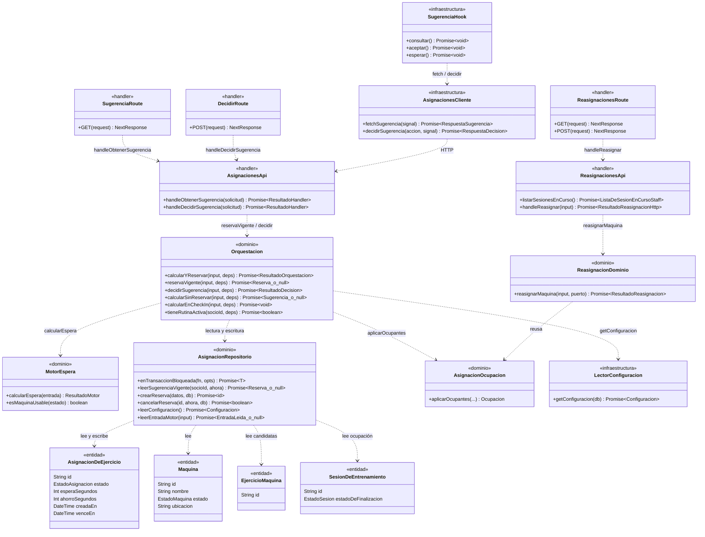
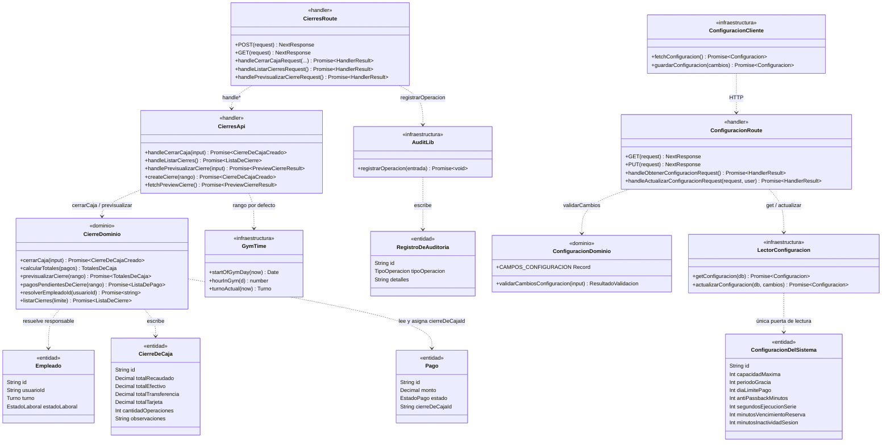

# 8) Diagrama de clases de diseño

> **Fuente**: `arnold/src` al 2026-11-16. El código es **funcional**: cada módulo se representa como
> una clase con estereotipo y sus **operaciones públicas reales** (firma simplificada en tipos, no en
> semántica). Solo lo que existe.
> **Estereotipos**: `<<handler>>` = `route.ts` y `src/api`; `<<dominio>>` = `src/domains`;
> `<<infraestructura>>` = `src/lib` y los helpers de cliente; `<<entidad>>` = modelos de Prisma.
> **Notación**: los genéricos se escriben `Promise~T~` y las uniones con `A_o_B` para que Mermaid no
> las interprete. Las dependencias `..>` son reales (import o llamada), no ideales.

## Leyenda de nombres

| En el diagrama | En el código |
|---|---|
| `CuotaDominio`, `CierreDominio`, `SesionDominio` | módulos de `src/domains` cuyo nombre coincide con una entidad |
| `Cuota`, `CierreDeCaja`, `SesionDeEntrenamiento` | modelos de `prisma/schema.prisma` |
| `ApiError` | `src/utils/api-error.ts` (se usa en la UI) |

---

## 1. Subsistema: acceso y pagos

```mermaid
classDiagram
    class LoginRoute <<handler>> {
        +POST(request) NextResponse
    }
    class AuthApi <<handler>> {
        +handleLoginRequest(body, context) Promise~LoginResult~
    }
    class AuthLib <<infraestructura>> {
        +comparePassword(plain, hash) Promise~boolean~
        +createJWT(userId, ttl, payload) string
        +hashPassword(plain) Promise~string~
    }
    class RefreshLib <<infraestructura>> {
        +issueRefreshToken(usuarioId) Promise~RefreshEmitido~
        +findRefreshTokenByValue(token)
    }
    class AuditLib <<infraestructura>> {
        +recordAccessAttempt(entrada) Promise~void~
        +registrarOperacion(entrada) Promise~void~
        +getRequestContext(request) AuditContext
    }
    class RouteErrorMapper <<infraestructura>> {
        +mapErrorToResponse(error, opciones) Mapeo
    }
    class ApiErrorUtil <<infraestructura>> {
        +throwIfNotOk(response, fallback) Promise~void~
        +handleApiError(error, fallback) string
    }
    class CheckInRoute <<handler>> {
        +POST(request) NextResponse
        +handleCheckInRequest(input) Promise~HandlerResult~
    }
    class AccesoApi <<handler>> {
        +handleCheckIn(input) Promise~CheckInResultado~
        +evaluarYRegistrarAcceso(prisma, socio, opts) Promise~CheckInResultado~
        +checkIn(input) Promise~CheckInResultado~
    }
    class CheckInDominio <<dominio>> {
        +decidirAcceso(entrada) DecisionAcceso
        +normalizeDNI(dni) string
        +estadoCuentaDe(estado) EstadoCuenta
    }
    class CuotaDominio <<dominio>> {
        +planDePago(input) PlanDePago
        +estadoCuotaSocio(input) EstadoCuotaSocio
        +periodoDe(fecha) string
        +diaLimiteDelMes(hoy, dia, gracia) Date
    }
    class OfertaDominio <<dominio>> {
        +evaluarOferta(tx, socioId, config, estado, hoy) Promise~Evaluacion~
        +aplicarOferta(input) Cobro
    }
    class PagosRoute <<handler>> {
        +POST(request) NextResponse
        +handleRegistrarPagoRequest(body) Promise~HandlerResult~
    }
    class PagosApi <<handler>> {
        +handleRegistrarPago(input) Promise~PagoRegistrado~
        +createPago(input) Promise~PagoRegistrado~
    }
    class RegistrarPago <<dominio>> {
        +registrarPago(input) Promise~PagoRegistrado~
    }
    class Usuario <<entidad>> {
        String id
        String email
        String password
        Rol rol
        EstadoUsuario estado
        DateTime deletedAt
    }
    class Socio <<entidad>> {
        String id
        String dni
        EstadoCuota estadoCuota
        String pinHash
    }
    class Cuota <<entidad>> {
        String id
        DateTime fechaInicio
        DateTime fechaVencimiento
        EstadoCuotaModel estado
    }
    class Pago <<entidad>> {
        String id
        Decimal monto
        MetodoPago metodoPago
        EstadoPago estado
        Decimal montoLista
        Decimal descuentoPct
    }
    class Asistencia <<entidad>> {
        String id
        DateTime fechaHora
        EstadoAlIngresar estado
        MetodoIdentificacion metodo
    }
    class AuditoriaAcceso <<entidad>> {
        String id
        AccionAcceso accion
        ResultadoAcceso resultado
        String motivo
    }

    LoginRoute ..> AuthApi : handleLoginRequest
    AuthApi ..> AuthLib : comparePassword / createJWT
    AuthApi ..> RefreshLib : issueRefreshToken
    AuthApi ..> AuditLib : recordAccessAttempt
    AuthApi ..> Usuario : lee
    AuthApi ..> RefreshLib : escribe
    AuthApi ..> AuditoriaAcceso : escribe
    CheckInRoute ..> AccesoApi : handleCheckIn
    AccesoApi ..> CheckInDominio : decidirAcceso
    AccesoApi ..> CuotaDominio : estadoCuotaSocio
    AccesoApi ..> Asistencia : escribe
    AccesoApi ..> AuditoriaAcceso : escribe
    PagosRoute ..> PagosApi : handleRegistrarPago
    PagosApi ..> RegistrarPago : registrarPago
    RegistrarPago ..> CuotaDominio : planDePago / estadoCuotaSocio
    RegistrarPago ..> OfertaDominio : evaluarOferta / aplicarOferta
    RegistrarPago ..> Cuota : escribe
    RegistrarPago ..> Pago : escribe
    RegistrarPago ..> Socio : lee
    PagosRoute ..> RouteErrorMapper : mapea errores
    PagosApi ..> RouteErrorMapper : mapea errores
    PagosRoute ..> AuditLib : registrarOperacion
    ApiErrorUtil ..> RouteErrorMapper : consume su message
```



## 2. Subsistema: entrenamiento

```mermaid
classDiagram
    class SesionesRoute <<handler>> {
        +POST(request) NextResponse
        +GET(request) NextResponse
        +PUT(request, params) NextResponse
    }
    class SeriesRoute <<handler>> {
        +POST(request, params) NextResponse
    }
    class SesionesApi <<handler>> {
        +handleIniciarSesion(input) Promise~SesionIniciada~
        +handleRegistrarSerie(input) Promise~SerieRegistrada~
        +handleFinalizarSesion(input) Promise~Sesion~
        +handleSesionEnCurso(socioId) Promise~Detalle_o_null~
        +iniciarSesionDeEntrenamiento(input) Promise~SesionIniciadaDTO~
        +registrarSerieDeEntrenamiento(id, input) Promise~SerieRegistradaDTO~
        +finalizarSesionDeEntrenamiento(id) Promise~Sesion~
    }
    class SesionDominio <<dominio>> {
        +iniciarSesion(input) Promise~SesionIniciada~
        +registrarSerie(input) Promise~SerieRegistrada~
        +finalizarSesion(input) Promise~Sesion~
        +detalleSesionEnCurso(socioId) Promise~Detalle_o_null~
        +seguimientoDeEjercicios(input) Promise~Seguimiento~
        +resumenDeSesion(sesionId) Promise~ResumenSesion~
    }
    class IntegracionAsignaciones <<dominio>> {
        +esClienteConAsignaciones(db) boolean
        +leerReservaVigenteParaSesion(db, socioId, ahora) Promise~Reserva_o_null~
        +consumirReservaParaSesion(db, id, sesionId, ahora) Promise~boolean~
        +crearEjecucionParaSesion(db, datos) Promise~void~
        +completarEjecucionParaSesion(db, sesionId, ejercicioId) Promise~void~
        +completarEjecucionesDeSesion(db, sesionId) Promise~void~
        +maquinaUnicaDe(db, ejercicioId) Promise~string_o_null~
    }
    class TipoSerieDominio <<dominio>> {
        +esTipoSerie(valor) boolean
        +TIPOS_ELEGIBLES readonly
        +ETIQUETAS_TIPO_SERIE Record
    }
    class ProgresionDominio <<dominio>> {
        +sugerirProximaCarga(input) Sugerencia
        +rachaDeFallos(sesiones) number
        +leerSesion(registros) SesionLeida
    }
    class MarcasDominio <<dominio>> {
        +estimar1RM(carga, reps) number_o_null
        +mejoresMarcas(series) Marcas
        +detectarMarcasNuevas(hoy, anteriores) MarcasNuevas
        +fronteraDeRecords(series) ListaDeSerieMarca
    }
    class ResumenDominio <<dominio>> {
        +compararConUltimaVez(hoy, anterior) Tendencia
        +resumirEjercicio(input) ResumenEjercicio_o_null
    }
    class RutinasRoute <<handler>> {
        +POST(request) NextResponse
    }
    class RutinasApi <<handler>> {
        +handleAsignarRutina(input) Promise~RutinaAsignada~
        +createAsignacionRutina(input) Promise~RutinaAsignada~
    }
    class AsignarRutina <<dominio>> {
        +asignarRutina(input) Promise~RutinaAsignada~
        +listarRutinasDeSocio(socioId) Promise~ListaDeRutinaAsignada~
    }
    class SesionDeEntrenamiento <<entidad>> {
        String id
        DateTime horaInicio
        DateTime horaFin
        EstadoSesion estadoDeFinalizacion
        String ejercicioActualId
        Int serieActual
    }
    class RegistroDeProgreso <<entidad>> {
        String id
        Decimal carga
        Int repeticiones
        Int rir
        Int numeroSerie
        TipoSerie tipo
        DateTime fecha
    }
    class RutinaAsignada <<entidad>> {
        String id
        Boolean activa
        DateTime fechaAsignacion
    }
    class Rutina <<entidad>> {
        String id
        String nombre
        Int frecuenciaSemanal
        Int duracionEstimada
    }
    class EjercicioEnRutina <<entidad>> {
        String id
        Int series
        Int repeticiones
        Int descanso
        Int orden
    }

    SesionesRoute ..> SesionesApi : handle*
    SeriesRoute ..> SesionesApi : handleRegistrarSerie
    SesionesApi ..> SesionDominio : iniciar / registrar / finalizar
    SesionDominio ..> IntegracionAsignaciones : reserva y ejecución
    SesionDominio ..> TipoSerieDominio : validar tipo
    SesionDominio ..> ProgresionDominio : seguimiento
    SesionDominio ..> MarcasDominio : récords
    SesionDominio ..> ResumenDominio : resumen
    SesionDominio ..> SesionDeEntrenamiento : lee y escribe
    SesionDominio ..> RegistroDeProgreso : escribe
    SesionDominio ..> RutinaAsignada : lee
    RutinasRoute ..> RutinasApi : handleAsignarRutina
    RutinasApi ..> AsignarRutina : asignarRutina
    AsignarRutina ..> RutinaAsignada : escribe
    EjercicioEnRutina ..> Rutina : pertenece
```



## 3. Subsistema: asignación dinámica



## 4. Subsistema: caja y configuración



---

## Arquitectura en capas real

### Capas y dirección de dependencias

```
src/app (route.ts, page.tsx)
   ├──▶ src/api (handlers de aplicación + helpers de fetch)
   │        └──▶ src/domains (reglas puras / con repositorio inyectado)
   │                 └──▶ src/utils (puro)
   ├──▶ src/components / src/contexts / src/hooks (UI)
   └──▶ src/lib (infraestructura: Prisma, auth, config, auditoría, errores)
```

- **`src/app`**: solo binding. `route.ts` autentica, valida la forma, llama a `handleXRequest` y
  traduce el resultado a `NextResponse` (`src/app/api/pagos/route.ts:26-42`).
- **`src/api`**: handlers de aplicación testeables sin `NextRequest`; también contiene los helpers
  de `fetch` del navegador (`src/api/pagos.ts:65-84`).
- **`src/domains`**: reglas de negocio. **Debe ser puro**: sin React, sin Prisma estático. Cuando
  necesita datos, recibe el cliente por parámetro o hace `await import("@/lib/db")`.
- **`src/lib`**: Prisma (`db.ts`), auth, configuración, auditoría, rate limit, mapeo de errores,
  tiempo del gimnasio.
- **`src/utils`**: formato, validación, `ApiError`/`handleApiError`, ids.

### Reglas que la protegen (tests guardián)

| Guardián | Qué prohíbe | Archivo |
|---|---|---|
| **Dominios puros** | Un `import` **estático** de `@/lib/db` en cualquier archivo de `src/domains` (arrastraría Prisma al bundle del navegador). Permite el diferido `await import`. | `src/domains/dominios-puros.guard.test.ts:4-30` |
| **Cliente sin servidor** | Un `import` estático de `@/lib/auth` (bcryptjs, jsonwebtoken, `node:crypto`) en `src/domains/cliente/cliente.ts`; exige la carga diferida. | `src/domains/cliente/cliente.guard.test.ts:4-20` |
| **Lector único de configuración** | Que cualquier archivo de `src` (salvo `src/lib/configuracion.ts`) mencione `configuracionDelSistema`. | `src/lib/configuracion.guard.test.ts:4-28` |
| **Matriz de roles coherente** | Que `ROLE_GATE_MATRIX` y `hasRouteAccess` discrepen para cualquier ruta/rol. | `src/middleware/matrix-consistency.test.ts:1-30` |
| **RN-06 contra los specs** | Que la matriz de autorización se aparte de lo que dicen los specs de ejercicios, rutinas, clientes, membresías y home. | `src/middleware/rn06-spec.test.ts:1-25` |

### Patrón de ruta

1. `route.ts`: `extractUserFromRequest` → rol → lectura de body (`readJsonBody`) → `handleXRequest`.
2. `handleXRequest` (`src/api`): delega en el dominio y mapea errores con `mapErrorToResponse`.
3. Dominio: valida reglas y, si escribe, abre **una** transacción con el aislamiento que necesita.
4. `src/lib`: Prisma, auditoría y utilidades de infraestructura.

### Excepciones reales a la regla de dependencia

- Los **helpers de `fetch`** viven en `src/api` junto a los handlers, así que la UI importa `src/api`.
- `src/lib/route-error-mapper.ts` importa la constante de una ruta en un caso puntual (documentado
  en `Proyecto/Arquitectura` del vault).
- Los **repositorios no son puertos** en todos los casos: `asignacion-repositorio.ts` **sí** se parte
  en puerto + implementaciones (`asignacion-puerto.ts`, `-lecturas`, `-ocupacion`, `-escrituras`),
  mientras que los CRUD acceden a Prisma desde su módulo de dominio con `await import`.
